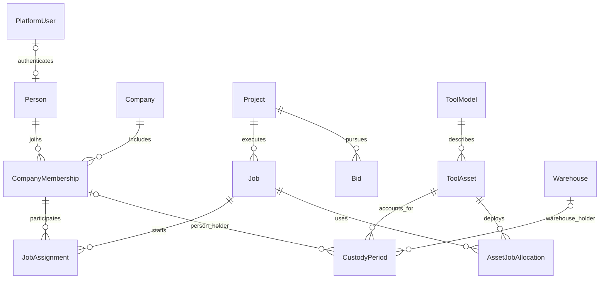

# Nelson Electric database proposal

This proposal establishes shared company, people, project, and job records for Nelson Electric, with tool custody as the first business application. A later bidding application can use those same identities and project records. Start with one Django application deployment and PostgreSQL database, organized into company, work, equipment, and later estimating modules. Separate frontends need not imply separate databases or duplicated employees.

This is a proposed domain model, not a transcription of the demo and not an applied migration. The installed implementation lives in `backend/`; its checked OpenAPI contract defines the current public API.

## Decisions behind the model

1. A login, person, company membership, job assignment, and permission grant are different records with different lifetimes.
2. A project describes the underlying customer work and can exist before an award. A job describes a piece of execution work. Multiple bids and jobs can relate to one project.
3. Custody means responsibility for an individual asset. Location means where it was observed. Job allocation means what work it is assigned to support. None implies either of the others.
4. A request always names a specific physical tool asset; requesting any unit of a model is not supported. A request does not move a tool. A reservation does not move a tool. A completed physical handoff does.
5. Loss and damage are separate facts. A tool can be damaged and missing simultaneously. Loss does not erase the accountable custodian.
6. Current state should have one authority. Current custody is the open custody period; current assignments are effective intervals. Dashboard counts and labels are queries.
7. Company rules control self-service job participation. Administrators retain explicit assignment authority. The user selected support for both administrator assignment and configurable worker self-service.
8. Company policy controls whether employees can register new tools, including their photos. Managers and administrators can switch employee registration on or off.
9. Build the shared foundations and tool domain now. The estimating models below define a compatible destination, not a requirement to build the bid application first.

## Sources and deliberate changes

The current [job documentation](JOBS.md) establishes multiple simultaneous jobs per person, assignment history, archiving, and independence from tool custody. The checked API contract and current backend establish individual tool units, warehouses, acceptance-based handoffs, damage/loss reports, evidence, audit, and reconciliation.

Preserve those domain needs. Change these demo assumptions:

| Demo behavior | Proposed behavior |
| --- | --- |
| A user has one worker/admin/warehouse role | Company membership and scoped permission grants coexist with job responsibilities. |
| Workers always join or leave any active job | Company policy selects direct, approval-required, or disabled self-service independently for joining and leaving. |
| Employees can add tools whenever the add-tool flow is available | A company setting enables or disables employee tool registration; the API enforces it on every new registration. |
| Removing a person automatically returns their tools | Suspend access immediately; preserve custody until actual receipt or an explicit, evidenced reconciliation. |
| Job name is the unique business identifier | Company job number is unique. Names can repeat. Preserve old numbers after archive. |
| Lost and damaged share a condition enum | Separate serviceability from missing-asset incidents. |
| Warehouse responsibility may be inferred from holder | Record the responsible warehouse explicitly; accepted warehouse receipt updates it according to a defined rule. |
| Approving a request immediately changes custody | Approval creates a pending handoff; it does not reserve the tool or establish custody. Recipient acceptance records receipt. |
| Editing a unit can change its shared definition | Edit the unit and catalog model through separate commands and separate revisions. |

## Common conventions

Business entities use UUID primary keys. Store instants in UTC and company timezone separately. Money uses decimal amounts plus ISO currency codes; quantities and rates use decimals with explicit units. Never use floats or formatted currency strings as financial authority.

Tables below omit repeated `id`, `created_at`, and `updated_at` columns unless their meaning needs explanation. Mutable command targets also carry a monotonically increasing `revision`. History records retain effective time and recording time where corrections or delayed entry matter. Use explicit status vocabularies with database checks; Django choices alone are not database constraints.

Company is the ownership boundary, even if Nelson Electric is the only company initially. Use `company_id` on company-owned aggregate roots. A child can inherit company through its parent when all its relationships are unambiguous. When a child joins two company-owned records, enforce that both belong to the same company with composite foreign keys using `(company_id, id)`. The backend declares these with `ScopedForeignKey` in model `Meta.constraints`, making them visible to Django migration detection, and checks the migrated PostgreSQL schema against those declarations. Ordinary UUID foreign keys do not guarantee company consistency.

Foreign keys that carry business history use `PROTECT`/database restrictive behavior. Archive identities rather than cascading away assignments, custody, or evidence. Cascade is appropriate only for disposable, unissued draft children with no independent history. Disabling access does not delete a person or transfer their possessions.

Use actual foreign keys for core domain relationships. Avoid generic `(type, id)` references for people, jobs, custody, evidence ownership, or financial lines. JSON is appropriate for bounded event metadata and immutable external snapshots, not substitute relationship tables.

## Company and people



Each custody period has a person holder or warehouse holder, exclusively; the diagram's optional relationships are constrained by that XOR rule.

| Model | Important fields and relationships | Meaning and constraints |
| --- | --- | --- |
| `Company` | `legal_name`, `display_name`, `timezone`, `default_currency`, structured address, `archived_at` | The company operating the application. Currency is a default, not permission to combine different currencies. |
| `Person` | `identity_user -> cleanforce_identity.PlatformUser` nullable and unique, `preferred_name`, `legal_name`, contact email, phone | A real person can be recorded before they have an account. Contact details are not credentials. |
| `CompanyMembership` | `company`, `person`, `employee_number` nullable, `relationship_kind` employee/contractor, `joined_at`, `ended_at`, `access_state` active/suspended/disabled, `title`, `home_warehouse` nullable | One durable membership per company/person. Rehire reactivates this identity; employment episodes can be separate records if needed later. Employment dates and access suspension are different facts. Employee number unique within company when present. |
| `MembershipInvitation` | `company`, intended `membership` nullable, normalized email, token digest, inviter, `expires_at`, `accepted_at`, `revoked_at` | Invites are not fake users. Token is single-use; store only its digest. Permission grants become effective only through an authorized acceptance workflow. |
| `CompanyRoleGrant` | `membership`, `role_code`, `granted_by`, `granted_at`, `revoked_at` | Codes such as company_admin, equipment_manager, field_member, dispatcher, estimator. One unrevoked grant per membership/role. Capabilities for each code live in reviewed application policy initially. |
| `WarehouseRoleGrant` | `membership`, `warehouse`, `role_code`, grant/revoke provenance | Warehouse-specific authority. Multiple managers are possible. Being a warehouse's named contact is not enough to authorize inventory operations. |
| `JobRoleGrant` | `membership`, `job`, `role_code`, grant/revoke provenance | Explicit job-scoped authority where needed. Job assignment describes participation; a grant determines authority. Do not require generic role customization or a permission editor for launch. |

CleanForce already owns passwords, login/recovery state, sessions, and authentication identities. Do not create another password table or assume its `PlatformUser` is Django's configured `AUTH_USER_MODEL`; the current package has its own managed identity model. Reference that model explicitly.

Company administrators, dispatchers, and estimators are not mutually exclusive person types. Being a foreman on a job is a job responsibility, not a global account role. A `lead` assignment can imply a reviewed job-scoped capability when policy deliberately says so; do not also store a duplicate grant for the identical fact. Use `JobRoleGrant` for independently delegated access.

## Projects and jobs

| Model | Important fields and relationships | Meaning and constraints |
| --- | --- | --- |
| `BusinessParty` | `company`, `display_name`, `legal_name`, external reference, contact details, structured address, `archived_at` | Customer, general contractor, supplier, or service provider. This is an external counterparty, distinct from an operating `Company`. Roles come from its relationships, not one exclusive party-type enum. |
| `BusinessContact` | `company`, `party`, name, email, phone, title, `archived_at` | A customer contact does not need a login or employee membership. |
| `Project` | `company`, unique project number, name, primary customer nullable, lifecycle prospective/active/closed/cancelled, description, `archived_at` | Stable identity for the real-world work before and after bidding. A customer can be unknown during early estimating. |
| `ProjectParty` | `project`, `party`, `relationship_code`, primary contact nullable | Associates owner, architect, GC, and other participants without forcing the project to have only one external company. Unique project/party/relationship. Add when these relationships are captured. |
| `Site` | `company`, name, structured address, access notes, `archived_at` | Physical work location. One location may host multiple projects. Embed ordinary address fields here; a global address identity service adds no value. |
| `ProjectSite` | `project`, `site` | Real many-to-many relationship for work spanning locations. Unique pair. |
| `Job` | `company`, `project`, unique company job number, name, status planned/active/on_hold/completed/cancelled, scheduled dates, actual dates, `archived_at`, `revision` | Execution scope, phase, or contract of a project. Completion and archival are different. Multiple jobs may belong to one project. |
| `JobSite` | `job`, `site` | Allowed sites for this job. Must also be a site of its project, enforced in the command and by a constraint trigger if stored as independent rows. |
| `JobAssignmentPolicy` | one-to-one `company`, `self_join_mode`, `self_leave_mode`, `revision` | Each mode is direct/approval_required/disabled. Defaults are deliberate configuration, not scattered route checks. Start with one company policy and no job-level overrides. |
| `JobAssignment` | `job`, `membership`, `responsibility_code` crew/foreman/supervisor, `starts_at`, `ends_at` nullable, `assigned_by`, `ended_by` nullable, assignment/end reason | Effective interval of real participation. Many jobs per person. No overlapping intervals for the same job/person. Responsibility changes close the previous interval and open a new one. |
| `JobParticipationRequest` | `job`, subject membership, requester, `intent` join/leave, requested responsibility, `target_assignment` for leave, `request_key`, status pending/approved/rejected/withdrawn, `policy_revision`, requested/decided times, decider, reason, resulting assignment nullable | Intent and approval history. A pending request is not an assignment. A leave request names the exact assignment so late approval cannot end a newer assignment. One pending request per person/job/intent. |

Joining directly creates the assignment and an approved participation request in the same transaction. Approval-required creates only the request. Disabled self-service creates neither. Admin assignment bypasses the self-service mode only with `jobs.assign`; it still checks active membership, job lifecycle, eligibility, and overlap. Self-join can create only the default crew responsibility; it cannot self-promote someone to foreman.

Self-leave follows its own company mode. Approval rechecks current authorization, subject eligibility, job state, and the referenced assignment. A policy change does not silently approve old pending requests. An administrator may explicitly decide them under current administrator authority.

To preserve the current job archive intent, archive closes open assignments, rejects or withdraws pending participation requests with a reason, and prevents new assignments atomically. Tools and job allocations are not silently moved. Restoring a job does not resurrect prior assignments. A person's access suspension need not end their actual work assignment; an employment end should close assignments explicitly while retaining tool accountability.

If future scheduling is needed, add `PlannedJobAssignment` for proposed dates/allocation. Do not confuse a staffing forecast with actual participation or access. Likewise, add crews and crew membership only when the company needs crew-level operations; direct person-to-job assignments are enough initially.

## Equipment catalog and assets

| Model | Important fields and relationships | Meaning and constraints |
| --- | --- | --- |
| `ToolRegistrationPolicy` | one-to-one `company`, `employee_tool_creation_enabled` boolean, `revision`, `updated_by` membership, `updated_at` | Company-wide switch for employee registration of new physical tools, including registration photos. Managers and administrators with company-scoped policy authority can change it. |
| `Warehouse` | `company`, unique company code, name, structured address, `archived_at` | A company-controlled inventory location. Archive only after open operational responsibilities are resolved. Multiple managers are role grants. |
| `ToolCategory` | `company`, name, normalized name, `archived_at` | Classification. Unique normalized name per company. IDs survive renaming. |
| `ToolModel` | `company`, `category`, name, manufacturer name, model number, specification text, default photo, `archived_at`, `revision` | Shared catalog description of a kind of tool. No quantity or custodian. Manufacturer/model is not globally unique unless the business can establish that rule. |
| `ToolAsset` | `company`, `tool_model`, unique company asset tag, serial nullable, acquisition date/cost/currency, `origin_warehouse`, `responsible_warehouse`, lifecycle active/retired/disposed, serviceability serviceable/damaged/out_of_service, `retired_at`, reason, `revision` | One physical item. Origin is acquisition provenance; responsible warehouse is current operational stewardship. No stored UI status or arbitrary quantity. |
| `ToolAssetIdentifier` | `asset`, scheme barcode/qr/legacy_tag, normalized value, `retired_at` | Optional additional scan identifiers. Unique active company/scheme/value; retain retired identifiers to resolve historical references. Build when multiple identifiers are needed. |
| `AssetLifecycleEvent` | `asset`, from/to lifecycle, actor, effective/recorded time, reason, evidence | Records retirement, disposal, and authorized reactivation. Distinguish a damaged asset from an asset permanently removed from service. |

The tag identifies the company asset. A missing serial is null; do not globally require unique serials across manufacturers or tool types. Catalog quantities are counts of assets. Consumable materials and stock quantities belong to a later inventory domain rather than pretending individual tools are quantities.

Keep acquisition cost on the physical unit. A future estimate's equipment allowance is a price snapshot, not a live reference to this cost. Never calculate historical bid prices from today's inventory values.

### Employee tool registration policy

Here, uploading a tool means registering a new physical tool and attaching its registration photo. The company setting is a simple on/off switch; it does not introduce an approval queue.

| Actor and setting | Result |
| --- | --- |
| Eligible active employee; setting enabled | May register a new tool through the employee registration command. |
| Employee without management authority; setting disabled | Cannot register a new tool. The API rejects the command even if an old screen still shows Add tool. |
| Authorized manager or administrator | May register tools through their management authority, independent of the employee switch. |
| Manager or administrator with `tools.manage_registration_policy` for this company | May enable or disable employee registration. |

Grant company-scoped `tools.manage_registration_policy` to the equipment_manager and company_admin roles. A job title alone does not authorize this company-wide change. Warehouse-scoped management grants continue to govern their own warehouses; company policy management requires the explicit company capability. Managers' asset registration authority must still cover the destination warehouse and company.

An enabled switch permits eligible employees to register assets; it does not permit editing existing shared catalog definitions, choosing another person's custody without acceptance, or bypassing company/warehouse validation. Registration can select an existing tool model or create a validated new model where the registration command supports that. Turning the switch off preserves previously registered assets and their history. Photos used as evidence on existing incidents or handoffs follow those operations' own permissions.

Both employee registration and policy updates lock the same company's policy row for the short database transaction. Registration rechecks the setting before creating the tool, initial custody, and audit job atomically. The update uses `expected_revision`, increments revision, and records the actor and old/new value through CleanForce audit. An employee registration serialized after disabling the setting is denied. Missing policy configuration denies employee registration until configured.

Photo bytes upload outside the database transaction. Authorize upload initiation for the registration purpose, and recheck the policy when finalizing the tool record; a previously issued upload URL does not authorize registration after the switch is disabled. An unused staged photo expires through normal upload cleanup. Store `registered_by` and `registered_at` on the asset so employee-created records retain their provenance.

Implementation evidence must cover employee registration when enabled and disabled, manager/admin registration while disabled, unauthorized policy updates, stale policy revisions, concurrent disable/register ordering, and disabling after a photo upload starts but before the tool is finalized.

## Custody and job use

| Model | Important fields and relationships | Meaning and constraints |
| --- | --- | --- |
| `CustodyPeriod` | `asset`, `holder_membership` nullable, `holder_warehouse` nullable, `starts_at`, `ends_at` nullable, opening handoff nullable, opening reconciliation nullable | Exactly one holder column is non-null. Nonoverlapping intervals per asset; at most one open period. An active accounted-for asset must have one. Lost assets retain their last accountable holder. |
| `ToolRequest` | `company`, requester, required `asset`, `source_custody`, `request_key`, requested job nullable when job context is introduced, needed dates, note, status pending/approved/rejected/withdrawn/fulfilled, decider/time | The employee selects one tagged physical asset. The model is derived from that asset; there is no model-only request or automatic unit substitution. Approval is not receipt. Multiple employees may request the same unit, but one employee cannot have duplicate open requests for it. |
| `ToolReservation` | `asset`, `request` nullable, intended recipient, optional job, reservation time window, status active/fulfilled/cancelled/expired, creator | Optional until real reservation behavior is needed. Prevent overlapping active reservations for an individual asset. This is distinct from custody and can be omitted from launch. |
| `CustodyHandoff` | `asset`, `source_custody_period`, destination membership XOR warehouse, request nullable, proposer, proposed time, state pending/accepted/declined/cancelled/expired, destination/source confirmation actors and times as applicable, resolved time, reason, `revision` | Links the intended movement to the exact source custody interval. At most one pending actual handoff per asset. Multiple requests do not require multiple simultaneous handoffs. |
| `AssetJobAllocation` | `asset`, `job`, `starts_at`, `ends_at`, allocated/released by, purpose | Actual deployment to a job, independent of who holds the tool. One overlapping allocation per asset is the initial policy. Future reservations remain separate. |
| `AssetLocationObservation` | `asset`, observed warehouse XOR site, observer, `observed_at`, `recorded_at`, note, evidence | Optional observation, not custody authority. A stale scan cannot override current responsibility. Resolve conflicting observations explicitly. |

Normal handoff acceptance locks the asset and pending handoff, verifies the source custody is still open, checks the accepting party's scope, closes the old period, opens the new period, resolves the handoff, and enqueues audit in one transaction. The receiving worker can accept for themselves; a warehouse-authorized member accepts for that warehouse. Repeated acceptance returns the established outcome and creates no second period.

If a tool is issued in person from a warehouse, the issue command may record the recipient's prior request/consent and the warehouse's confirmed collection together. Otherwise, approval merely approves the request. Never infer physical receipt from a queue button's label.

An accepted warehouse return sets `responsible_warehouse` to the receiving warehouse. A worker-to-worker transfer keeps it. An administrative stewardship reassignment is a separate audited command. Job switching does not change any of these fields.

Do not use a job as a custodian initially. If the company later wants a site gang box to be independently accountable, give that storage unit its own identity and explicit custodial rules; a project name is not someone who can acknowledge receipt.

## Condition, evidence, and reconciliation

| Model | Important fields and relationships | Meaning and constraints |
| --- | --- | --- |
| `AssetIncident` | `asset`, kind damage/missing, reporter, observed/recorded time, description, state open/resolved, resolver/time, resolution code and note | Damage and missing incidents can coexist. One open incident of each kind per asset initially; additional observations can attach to it. Reporting missing does not close custody. |
| `AssetServiceEvent` | `asset`, type inspection/repair/calibration/condition_correction, performed by membership or service provider, occurred time, resulting serviceability, optional cost/currency, note | Explains serviceability changes and repairs. A found item can remain damaged; a repair does not resolve a missing report. Add scheduled maintenance only when needed. |
| `StoredFile` | `company`, opaque storage key, original filename, content type, byte count, checksum, uploader, upload/scan state, created time | Object bytes live in storage. Access checks happen before issuing a download URL. Store neither base64 photos nor permanent public URLs as evidence. |
| Typed evidence links | `IncidentAttachment`, `HandoffAttachment`, `ServiceEventAttachment`, `ReconciliationAttachment`, each with owner FK, file FK, caption, creator/time | A reusable file record plus explicit ownership links. A catalog photo is not interchangeable with a transfer receipt. No generic entity-id string relationship. |
| `ReconciliationCase` | `company`, kind duplicate_asset/custody_dispute/missing_asset, opened by/time, state open/resolved, assigned reviewer, narrative | A record of investigated uncertainty. Dashboard anomalies can be derived; persist a case when it has investigation, evidence, or decisions. |
| `ReconciliationCaseAsset` | `case`, `asset`, relation_code | Associates multiple affected assets without arrays of IDs. Unique case/asset. |
| `ReconciliationDecision` | `case`, decision maker/time, action, reason, evidence, relevant expected revisions | Immutable decision record. For a custody correction, connect the new custody period to this decision and retain prior history. |
| `AssetRecordMerge` | duplicate asset, canonical asset, decision, effective time | Preserve the duplicate identifier and its historical references. Reject cycles, cross-company merges, or two conflicting current custody records. Resolve conflict before merge; do not rewrite all old history to pretend records were always the same. |

For current screens, derive missing from an unresolved missing incident and damage from current serviceability. The domain can represent both even if a compact screen gives one label precedence. Retiring an asset closes operational allocations and pending actions, with an explicit custody/disposal outcome; retirement must not conceal unresolved loss.

Business histories are not reconstructed by parsing generic audit messages. Assignments, custody periods, incidents, and decisions retain their own relationships. CleanForce's audit stream records who invoked commands and their outcomes; it supplements these records.

## Bidding extension

These models belong in a later estimating module. The shared company, membership, permissions, parties, projects, sites, jobs, and files above need not be replaced.

| Model | Important fields and relationships | Meaning and constraints |
| --- | --- | --- |
| `Bid` | `company`, `project`, bid number, recipient party, estimator membership, due time, lifecycle, currency | A commercial pursuit. Multiple bids to different GCs can refer to the same project. |
| `BidRevision` | `bid`, revision number, draft/issued/superseded state, assumptions, exclusions, validity, authored/issued times, immutable pricing/rounding policy snapshot | Issued revisions are frozen; editing creates a new revision. Unique bid/revision number. |
| `EstimateSection` | revision, parent section nullable, code, title, display order | Work breakdown within one revision. Prevent parent cycles and cross-revision parents. |
| `EstimateLine` | section, description snapshot, quantity, unit, cost_code, optional source catalog item, material unit cost, labor hours per unit, labor rate, equipment/subcontract allowance, pricing inputs | Structured cost basis. Decimal units, rates, and amounts. Price snapshots remain unchanged when a catalog changes. |
| `BidAdjustment` | revision, adjustment type markup/tax/discount/allowance, basis, percentage or fixed amount, calculation order | Explicit calculation semantics. Do not bury taxes and markups in a line's description or one unexplained total. |
| `SupplierQuote` and `SupplierQuoteLine` | supplier, project/bid, reference, expiry, currency, item/quantity/unit price, linked files | Sources for pricing. Linking or copying a price into an estimate creates a snapshot; it does not keep a live price dependency. |
| `BidSubmission` | revision, recipient contact/party, submitted by/time, immutable generated document and recipient/address snapshots | Evidence of exactly what was sent and to whom. Delivery is a separate explicit action. |
| `BidAward` | accepted submission/revision, awarded scope, agreed amount/currency, awarded date, evidence | Explicit commercial acceptance. Partial awards do not mutate the issued estimate. |
| `JobAwardAllocation` | job, award, scope description, allocated amount | Connects awarded work to execution, supporting one award across jobs or a job funded by multiple awards. Monetary allocations must reconcile under an explicit business rule. |

Estimating labor classifications and rate cards are not worker login roles. Material catalog and assemblies are estimating concepts; they should not reuse `ToolAsset`. Purchase orders, payroll, invoices, and actual job costing are separate later domains. A bid is not a job, and creating a bid should not start staffing or custody workflows.

## Database rules and transaction boundaries

| Invariant | Enforcement |
| --- | --- |
| Unique company/job number, asset tag, membership/person pair | Database unique constraints. |
| Exactly one custody holder or handoff destination | Row check constraint over explicit nullable foreign keys. |
| Positive interval duration when end exists | Row check; use half-open intervals `[start, end)`. |
| No overlapping custody or job-assignment intervals | PostgreSQL exclusion constraints on asset or job/person plus time range; `btree_gist` migration where needed. A partial unique constraint protects one open interval but does not protect historical overlaps. |
| One open custody period | Partial unique constraint enforces at most one. Application commands create initial custody and preserve existence atomically. There is no deferred existence trigger in the current backend; arbitrary database writers can bypass this rule. A unique constraint alone cannot prove at least one exists. |
| Same company for connected records | Model-declared composite foreign keys, migration checks, and PostgreSQL drift verification; scoped queries and explicit command checks additionally protect requests. |
| No stale transfer acceptance | Asset row lock, source interval comparison, handoff transition validation, expected revision where caller state matters. |
| Safe archive and restore | Job lock and one transaction closing assignments/requests; do not reopen history on restore. |
| Assignment request retry | Unique company/requester/idempotency key; bind key to operation and payload. Same key/different input is conflict. Replaying a request can return its current state, explicitly distinct from byte-identical HTTP replay. |
| Transactional history | Business writes and CleanForce audit job dispatch use the same database transaction. |
| Preserved history | Restrictive FKs, no general destructive CRUD on histories, application database role permissions, immutable issued/decision records; controlled correction operations retain provenance. |

PostgreSQL does not support ordinary CHECK constraints that inspect other rows/tables. Same-company and cross-record transition rules must not be described as checked by `Model.clean()` or by an ordinary CHECK when they are not. See [PostgreSQL constraints](https://www.postgresql.org/docs/current/ddl-constraints.html) and [Django PostgreSQL constraints](https://docs.djangoproject.com/en/5.2/ref/contrib/postgres/constraints/).

Indexes should serve actual lookup paths: open custody by holder, asset/time history, active assignments by membership and job, pending requests by company/job, incident state by asset, asset tags, and business keys. Do not add a second stored count or status merely because a screen displays it.

## CleanForce composition

Verified against local CleanForce commit `80ea29899246a4680f01624e03b896522770b6dd`:

- Consumer-owned Django models and migrations hold these business records. Do not put Nelson Electric models inside `backend_platform` or `cleanforce_identity`.
- `backend_platform.api.create_api` creates the governed API. Routes use `define_http_endpoint` or the higher-level endpoint helpers. Bare Ninja route decorators are not the supported registration path.
- `cleanforce_identity.users.facade.current_identity(request)` resolves the active identity including effective-user context. Reading raw session claims alone does not replace active-user resolution.
- `backend_platform.api` exposes typed client errors such as `forbidden`, `not_found`, and `conflict`.
- `backend_platform.audit` exposes `AuditActor`, `AuditSubject`, `build_audit_event`, and `record_audit_event`.
- The default audit recorder dispatches a durable platform job inside the transaction. Run the platform worker to materialize the audit event. Audit visibility can lag; the business transaction must not depend on the audit read model to know custody or assignments.
- Browser mutation endpoints need explicit CSRF protection, as CleanForce's own authentication routes use. Authentication and route registration do not automatically enforce company-specific authorization.
- CleanForce's richer declaration/compiled-operation facilities exist, but the small public HTTP helper is explicitly supported by its consumer example. The example here uses it deliberately; this is not fabricated CleanForce syntax.

## Vertical slice example

The [example models](examples/job_join/models.py), [service](examples/job_join/services.py), [API](examples/job_join/api.py), and [URL composition](examples/job_join/urls.py) show a worker joining a job. They cover authentication, company membership, fixed capability policy, job eligibility, configurable direct/approval/disabled behavior, retries, transactionally queued audit, and a typed response.

The example models are a reduced subset for readability. They omit the project relationship and other columns not read by this command, full lifecycle commands, tenant-integrity migrations, historical exclusion migrations, and the approval/leave endpoints. Those are still required for the full schema. The example does not implement the application or modify the existing frontend.

Example request:

```http
POST /api/companies/{company_id}/jobs/{job_id}/join
Content-Type: application/json
X-CSRFToken: <browser csrf token>
Cookie: <authenticated session>

{"request_key": "02dd9bf9-af5b-428d-b8b5-ff956b1cfe32"}
```

There is deliberately no caller-supplied actor ID. An approved result includes the created assignment ID; a pending result has no assignment. Self-service does not grant foreman authority and does not touch equipment custody.

The illustrative job-joining source has been checked against the actual CleanForce exports and Python syntax, but is not installed or exercised by the backend test suite. The implemented tool-request slice uses Python 3.13 and PostgreSQL with real HTTP/session/CSRF, integrity, and concurrency tests; see [backend verification](../backend/README.md#verification). The job-joining example still requires its own implementation and runtime verification.

Essential tests for implementation: anonymous denial; suspended/ineligible member denial; cross-company job denial; direct join creates one assignment and audit job; approval mode creates no assignment; disabled mode creates neither; archived/inactive job denial; repeated key returns one resource; key reuse for another job conflicts; concurrent joins do not duplicate; rollback of audit enqueue rolls back business rows; job archive and join serialize; approval cannot resurrect an archived job or end a newer assignment; a membership or permission revocation follows the same membership lock protocol.

## First implementation boundary

The first implemented slice is [the backend tool request API](../backend/README.md): real CleanForce authentication, company membership and roles, warehouses, tool models, individual assets, custody periods, and requests for a specific asset. It includes actual PostgreSQL migrations and HTTP/database tests. The job-joining code above remains an illustrative example rather than an installed feature.

The backend now implements manager request decisions and receipt-based custody, company-configurable employee registration, staged evidence, projects/jobs and configurable participation, condition/service/lifecycle commands, and evidenced reconciliation. See [the backend README](../backend/README.md) and its checked OpenAPI for the installed contract and operational limits. Reservations, observations, additional project relationships, and estimating tables remain later extensions.

This gives the bid application stable company, people, customer, project, and execution identities without making the first tool release carry an unfinished estimating system.
